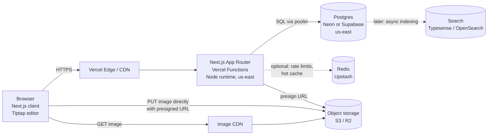

# System Design: A Full Stack Next.js Notes App

Design doc for a notes app built to grow from 50K to 10M users, with the reasoning behind each decision. Jargon is defined the first time it shows up, in a short parenthetical or a "Term:" note.

## Table of contents

1. [Goal](#1-goal)
2. [Product questions](#2-product-questions)
3. [Requirements](#3-requirements)
4. [Back-of-envelope estimates](#4-back-of-envelope-estimates)
5. [High-level architecture](#5-high-level-architecture)
6. [Next.js client/server split and API](#6-nextjs-clientserver-split-and-api)
7. [Data model](#7-data-model-postgres)
8. [Multi-device conflicts](#8-multi-device-conflicts)
9. [The write path at scale](#9-the-write-path-at-scale)
10. [Reads and caching](#10-reads-and-caching)
11. [Search](#11-search)
12. [Auth and security](#12-auth-and-security)
13. [Offline support (stretch)](#13-offline-support-stretch)
14. [Scaling roadmap](#14-scaling-roadmap)
15. [Reliability and observability](#15-reliability-and-observability)
16. [Tradeoffs summary](#16-tradeoffs-summary)

---

## 1. Goal

> A notes app where users create, edit, and organize rich text notes, built as a full stack Next.js application.

The first job is to turn that into numbers and a scope.

---

## 2. Product questions

### Product assumptions

| Question | Answer |
|---|---|
| Who is the user? | Individual knowledge workers. Think personal Notion or Apple Notes, not a team wiki. |
| How many users? | 50K at launch, 10M registered in 2 years, about 10% daily active (so 1M DAU at the 2-year mark). |
| Sharing and collaboration? | Private by default. Read-only share via link. No real-time co-editing in v1. |
| How do users organize notes? | Tags, with filter by tag. Folders are nice-to-have. |
| How big is a note? | Average about 2KB of text. Some power users have notes of 500KB or more. |
| How many notes per user? | Average 200. Long tail up to 50K. |
| What content types? | Rich text (headings, lists, links, checkboxes) plus image attachments. |

**Term: DAU** (daily active users). The number of distinct users who use the app on a given day.

### Other questions that shape the design

Where there is no firm answer yet, the working assumption is listed.

| Question | Why it matters | Assumption if not given |
|---|---|---|
| What is the read/write ratio? | Decides whether you optimize for reads (caching) or writes (the save path). Autosave makes notes apps unusually write-heavy. | Write-heavy by request count, because of autosave. |
| Offline? Multiple devices per user? | Multi-device means two copies of a note can diverge. That drives the conflict design in section 8. | Yes, laptop plus phone. Offline is a stretch goal. |
| Search? Titles only or full text? | Full-text search needs an index and possibly a separate system. | Full-text search over the user's own notes. |
| Latency and availability targets? | Gives you something concrete to design against. | Open a note in under 200ms p95. Save acknowledged in under 300ms p95. 99.9% uptime. |
| Version history? | Multiplies storage and adds a table. | Yes, keep a limited history (estimate 5x). |
| Data residency or compliance? | May force region choices. | Single region (US) for v1. |

**Term: p95** (95th percentile). "Under 200ms p95" means 95 out of 100 requests finish in under 200ms. Averages hide slow outliers, so percentiles make a better target.

**Term: 99.9% uptime** ("three nines"). About 43 minutes of downtime allowed per month.

---

## 3. Requirements

### Functional requirements (what the system does)

1. Sign up, sign in, sign out, from multiple devices.
2. Create, read, update (autosave), and delete notes.
3. Rich text editing: headings, lists, links, checkboxes.
4. Attach images to notes.
5. Tag notes and filter the note list by tag.
6. Search across your own notes.
7. Share a note as a read-only link, and revoke that link.
8. Edit the same note from two devices without silently losing work.

### Non-functional requirements (how well it does it)

| Property | Target |
|---|---|
| Latency | Note open under 200ms p95. Save acknowledged under 300ms p95. List page under 300ms p95. |
| Availability | 99.9% |
| Durability | A save the user saw as "Saved" is never lost. This beats availability in priority. |
| Consistency | A user sees their own writes immediately (read-your-writes). Shared links may lag by a few seconds. |
| Privacy | Notes are private by default. No user can read another user's note without a valid share token. |
| Scale | 10M registered users, 1M DAU, 2B notes. |

**Term: durability.** Once data is acknowledged as saved, it survives crashes and restarts.

**Term: read-your-writes consistency.** After you save, your own next read shows that save. Other viewers may see it a bit later.

### Scope for v1

| In scope | Out of scope (v1) |
|---|---|
| Notes CRUD with autosave | Real-time co-editing (Google Docs style) |
| Rich text and image attachments | Team workspaces, permissions beyond owner |
| Tags and tag filter | Folders (nice-to-have, easy to add later) |
| Full-text search | Native mobile apps (responsive web only) |
| Read-only share links | Comments, mentions, notifications |
| Conflict detection across devices | Full offline-first editing (stretch, section 13) |
| Basic version history | Public publishing / SEO pages |
| | AI features, import/export from other apps |

Saying out loud what you are not building is a signal of seniority. It also protects your time.

---

## 4. Back-of-envelope estimates

Write units at every step. The most common mistake in this section is a unit slip, not a bad assumption.

**Unit reminder:** 1 KB = 10^3 bytes, 1 MB = 10^6, 1 GB = 10^9, 1 TB = 10^12. Rounding to powers of 10 is fine for estimates.

### 4.1 Storage

**Notes (text)**

```
Users:          10M users
Notes per user: 200 notes/user
Total notes:    10M users x 200 notes/user = 2B notes  (2 x 10^9)
Size per note:  2 KB/note
Text storage:   2 x 10^9 notes x 2 x 10^3 bytes/note = 4 x 10^12 bytes = 4 TB
```

Sanity check: if you got 4,000 TB, you multiplied by 2,000 instead of 2,000 bytes (or treated KB as MB). That is a 1000x unit error. Saying "let me sanity check that" out loud and catching it is a plus, not a minus.

The 500KB power users and the 50K-note long tail are already inside the average. They matter for the write path (section 9), not for total storage.

**Version history**

```
Assume ~5 retained versions per note on average:
4 TB x 5 = 20 TB
```

20 TB fits on a single large managed Postgres cluster, though at that size you would want history in cheaper storage (section 9).

**Images**

```
Notes with an image: 10% x 2B notes = 200M notes
Size per image:      500 KB
Image storage:       2 x 10^8 x 5 x 10^5 bytes = 1 x 10^14 bytes = 100 TB
```

100 TB of binary blobs does not belong in a relational database. It goes in object storage (S3 or Cloudflare R2), and the database stores only a key that points to it.

**Term: object storage.** A service (S3, R2, GCS) that stores files ("objects") by key. Cheap per GB, very durable, served over HTTP. Not queryable like a database.

### 4.2 Traffic

**Term: QPS** (queries per second, sometimes "requests per second"). How many requests hit the system each second. You estimate average, then multiply by 2 to 5x for peak.

**Handy constant:** a day has 86,400 seconds. Round to ~100K (10^5) for mental math.

**Writes (autosave)**

```
DAU:                       10% x 10M = 1M users/day
Typing time per user:      ~10 min/day = 600 s/day
Save interval while typing: one save every ~5 s (debounced)
Saves per user per day:    600 s / 5 s = 120 saves/user/day
Total saves per day:       1M x 120 = 120M saves/day
Average write QPS:         120M / ~10^5 s = ~1,200 QPS   (exact: 120M / 86,400 = ~1,400)
Peak write QPS (3-4x):     ~5,000 QPS
```

**Term: debounce.** Wait until the user pauses typing for N milliseconds before doing something (here: saving). Every new keystroke resets the timer. Without it, you would send a save on every keystroke, which is 10 to 50x more traffic.

**Reads**

```
Note opens per user per day:  ~20
List / search loads per day:  ~10
Reads per day:                1M x 30 = 30M reads/day
Average read QPS:             30M / 10^5 s = ~300 QPS
Peak read QPS (3-4x):         ~1,200 QPS
```

Read/write ratio by request count is roughly **1 read : 4 writes**. That is unusual. Most web apps are read-heavy (100:1). A notes app with autosave is write-heavy, and that should change where you spend your design effort.

**Bandwidth on the write path**

```
Average case: 1,200 saves/s x 2 KB = 2.4 MB/s     (trivial)
Worst case:   if 1% of peak saves are 500 KB notes,
              50 saves/s x 500 KB = 25 MB/s       (noticeable, and each one rewrites a 500 KB row)
```

### 4.3 Conclusion from the numbers

- **Storage is easy.** 4 TB of text (20 TB with history) fits in managed Postgres. 100 TB of images goes to object storage, which is built for that.
- **Read traffic is easy.** ~300 QPS average is one well-indexed Postgres instance.
- **The autosave write path is the pressure point.** ~5,000 peak QPS of updates, some carrying 500KB payloads, each one rewriting a row. That is where the deep dive (section 9) goes.

---

## 5. High-level architecture



Same thing in ASCII, for a whiteboard:

```
                     +----------------------+
  Browser  --------> |  Vercel Edge / CDN   |
  (React,            +----------+-----------+
   Tiptap)                      |
     |                          v
     |               +----------------------+        +-----------------+
     |               |  Next.js App Router  | -----> | Redis (optional)|
     |               |  Node runtime        |        | rate limit/cache|
     |               |  region: us-east     |        +-----------------+
     |               +----+-----------+-----+
     |                    |           |
     |        SQL via     |           | presign
     |        pooler      v           v
     |            +-----------+   +------------------+
     |            | Postgres  |   | Object storage   |
     |            | (Neon/    |   | S3 / R2          |
     |            | Supabase) |   +--------^---------+
     |            +-----+-----+            |
     |                  | (later)          |
     |                  v                  |
     |            +-----------+            |
     |            | Search    |            |
     |            +-----------+            |
     +------- direct image upload ---------+
```

### Component choices

| Component | Choice | Why |
|---|---|---|
| Frontend + backend | Next.js App Router on Vercel | One codebase, Server Components for fast first paint, Route Handlers and Server Actions for the API. |
| Runtime | Node.js runtime (not Edge) | Postgres drivers and connection pooling work best on Node. Edge runtime has limits on TCP and Node APIs. |
| Region | Functions pinned to the same region as the database | Each request makes 1 to 3 DB round trips. A function in Europe talking to a DB in Virginia adds ~80ms per round trip, which blows the 200ms budget. |
| Database | Postgres (Neon or Supabase) | Relational data (users, notes, tags, many-to-many), strong consistency, transactions, `jsonb` for document content, built-in full-text search. One system covers v1. |
| Images | Object storage + presigned uploads | Keeps 100 TB of blobs out of the DB and keeps upload bytes off our servers. |
| Cache / rate limit | Redis (Upstash), optional in v1 | Per-user rate limiting across serverless instances needs shared state. |
| Search | Postgres FTS in v1, dedicated engine later | Do not add a system until you need it. |

**Why Postgres and not MongoDB / DynamoDB?** Always say which database and why. Notes have relationships (user to notes, notes to tags, notes to attachments) and we need conditional updates for conflict detection. Postgres gives us both, plus `jsonb` for the flexible document body, so we get document-store flexibility without giving up joins and transactions. DynamoDB would scale writes further but makes tag filtering and search harder, and we will not hit its scale ceiling for a long time.

**Term: presigned URL.** A short-lived URL that our server signs with its storage credentials, granting the browser permission to upload (or download) one specific object. The browser uploads straight to S3/R2, so large files never pass through our functions.

---

## 6. Next.js client/server split and API

### Pages

| Route | Rendering | What it does |
|---|---|---|
| `/` | Server Component | Paginated note list for the signed-in user: title, ~150 char snippet, tags, `updated_at`. No full content. Supports `?tag=` and `?q=` filters. |
| `/notes/[id]` | Server Component shell + Client Component editor | Server fetches the note (with auth check) and passes `content` and `version` as props. The editor hydrates on the client. |
| `/s/[token]` | Server Component, cacheable | Public read-only view of a shared note. Renders sanitized HTML. No editor JS. |
| `/login` | Mostly static | Auth provider UI. |

**Term: Server Component.** A React component that runs only on the server. It can query the database directly, and ships HTML (not its own JS) to the browser. Good for initial loads.

**Term: Client Component.** A React component (marked `"use client"`) that runs in the browser, with state and event handlers. Needed for anything interactive, like an editor.

**Term: hydration.** The browser attaching React event handlers to HTML that the server already rendered.

### The editor

- Client Component using **Tiptap** (built on ProseMirror) or **Lexical**. Both produce a structured JSON document, which is why we store content as `jsonb`.
- **Debounced autosave:** save ~1s after the user stops typing, with a **max-wait** of ~5s so a user who types continuously still gets saved regularly.
- Only save if the document is **dirty** (changed since the last successful save).
- Status indicator: "Saving...", "Saved", "Offline, will retry", "Conflict".

### Why autosave is a Route Handler and not a Server Action

Server Actions are great for form-like mutations. Autosave is a high-frequency background stream, and a plain `fetch` to a Route Handler gives more control:

| Need | Route Handler (`PATCH /api/notes/[id]`) | Server Action |
|---|---|---|
| Debounce on the client | Plain `fetch`, easy | Possible, but actions are designed around forms and transitions |
| Cancel an in-flight save when a newer one starts | `AbortController` works directly | No first-class abort |
| Retry with backoff on network failure | Standard fetch retry logic | Awkward |
| Return precise HTTP status (409, 413, 429) | Yes | Actions return values or throw, not HTTP codes |
| Rate limit per user at the HTTP layer | Middleware or handler, standard | Harder to target |
| Callable from a future mobile app | Yes, it is a normal REST endpoint | No, tied to the Next.js client |

Server Actions are still the right fit for one-off mutations like create, delete, add tag, and toggle sharing, because they integrate with `revalidatePath` and progressive enhancement.

**Term: AbortController.** A browser API that lets you cancel a `fetch` that is still in flight.

### Endpoints

| Method | Path / Action | Purpose | Notes |
|---|---|---|---|
| (RSC) | `/` | List notes | Cursor pagination, 50 per page |
| (RSC) | `/notes/[id]` | Initial note load | Returns content + version |
| `PATCH` | `/api/notes/[id]` | Autosave | Body: `{ title?, content \| ops, baseVersion }`. Upserts on first save. 200 with new version, 409 on conflict, 413 too large, 429 rate limited |
| `GET` | `/api/notes/[id]` | Refetch latest | Used after a 409, or when a tab regains focus |
| `GET` | `/api/notes?cursor=&tag=&q=` | List / search for client-side infinite scroll | |
| Server Action | `deleteNote(id)` | Soft delete | Sets `deleted_at` |
| Server Action | `restoreNote(id)` | Undo delete from Trash | |
| Server Action | `addTag(noteId, name)` / `removeTag(noteId, tagId)` | Tagging | Upserts the tag row |
| Server Action | `shareNote(id)` / `unshareNote(id)` | Generate or clear `share_token` | |
| `POST` | `/api/attachments/presign` | Get a presigned upload URL | Validates type and size before signing |
| `POST` | `/api/attachments/[id]/complete` | Confirm upload finished | Server checks object exists and size matches |
| (RSC) | `/s/[token]` | Public shared view | Read-only, cacheable |

### The orphan empty note problem

If clicking "New" immediately inserts a row, then every user who clicks New and then navigates away leaves an empty note behind. Over 10M users that is a lot of junk rows, and it clutters their list.

**Option A: lazy create (recommended).**

1. Clicking "New" generates a UUID on the client (`crypto.randomUUID()`) and navigates to `/notes/<uuid>` with an empty editor. No database write.
2. The first debounced save sends `PATCH /api/notes/<uuid>` with `baseVersion: 0`.
3. The server does an upsert: insert if the row does not exist, otherwise treat it as a normal versioned update.

```sql
INSERT INTO notes (id, user_id, title, content, version)
VALUES ($1, $2, $3, $4, 1)
ON CONFLICT (id) DO NOTHING
RETURNING version;
-- 0 rows returned: the row already exists, so fall through to the versioned UPDATE in section 8
```

Notes:
- The server must check that an existing row with that id belongs to the caller. Otherwise a user could guess an id and write into someone else's note.
- UUIDv4 has 122 random bits, so collisions are not a practical concern. UUIDv7 is a nice alternative because it is time-ordered and indexes better.

**Option B: create on click, then a cleanup job.** Insert immediately, and a scheduled job deletes notes that are still empty after 24 hours. Simpler client logic, but you pay for writes you throw away, need a cron job, and the empty notes can show up on other devices in the meantime.

Lazy create wins: zero wasted writes and no background job.

---

## 7. Data model (Postgres)

**Term: PK** (primary key). The column(s) that uniquely identify a row. Automatically indexed.

**Term: FK** (foreign key). A column that references the PK of another table. The database enforces that the referenced row exists. `ON DELETE CASCADE` means deleting the parent also deletes the children.

**Term: index.** A data structure (usually a B-tree) that makes lookups on certain columns fast, at the cost of slower writes and extra storage.

```sql
CREATE TABLE users (
  id          uuid PRIMARY KEY DEFAULT gen_random_uuid(),
  email       text NOT NULL UNIQUE,
  name        text,
  created_at  timestamptz NOT NULL DEFAULT now(),
  updated_at  timestamptz NOT NULL DEFAULT now(),
  deleted_at  timestamptz            -- soft delete
);

CREATE TABLE sessions (
  id          text PRIMARY KEY,      -- random, unguessable session id (stored in the cookie)
  user_id     uuid NOT NULL REFERENCES users(id) ON DELETE CASCADE,
  expires_at  timestamptz NOT NULL,
  created_at  timestamptz NOT NULL DEFAULT now()
);
CREATE INDEX sessions_user_id_idx ON sessions (user_id);

CREATE TABLE notes (
  id           uuid PRIMARY KEY,     -- client-generated for lazy create
  user_id      uuid NOT NULL REFERENCES users(id) ON DELETE CASCADE,
  title        text NOT NULL DEFAULT '',
  content      jsonb NOT NULL DEFAULT '{}',
  content_text text  NOT NULL DEFAULT '',  -- plain text from the editor JSON, for snippets and search
  version      int  NOT NULL DEFAULT 1,
  share_token  text UNIQUE,          -- NULL means not shared
  created_at   timestamptz NOT NULL DEFAULT now(),
  updated_at   timestamptz NOT NULL DEFAULT now(),
  deleted_at   timestamptz           -- soft delete (Trash)
);
CREATE INDEX notes_user_updated_idx ON notes (user_id, updated_at DESC);

CREATE TABLE tags (
  id       uuid PRIMARY KEY DEFAULT gen_random_uuid(),
  user_id  uuid NOT NULL REFERENCES users(id) ON DELETE CASCADE,
  name     text NOT NULL,
  UNIQUE (user_id, name)             -- each user has their own tag namespace
);

CREATE TABLE note_tags (
  note_id  uuid NOT NULL REFERENCES notes(id) ON DELETE CASCADE,
  tag_id   uuid NOT NULL REFERENCES tags(id)  ON DELETE CASCADE,
  PRIMARY KEY (note_id, tag_id)      -- composite PK, no duplicate tagging
);
CREATE INDEX note_tags_tag_idx ON note_tags (tag_id);  -- for "all notes with tag X"

CREATE TABLE attachments (
  id           uuid PRIMARY KEY DEFAULT gen_random_uuid(),
  note_id      uuid NOT NULL REFERENCES notes(id) ON DELETE CASCADE,
  storage_key  text NOT NULL,        -- e.g. "u/<user_id>/<uuid>.png" in S3/R2
  mime_type    text NOT NULL,
  size_bytes   int  NOT NULL,
  created_at   timestamptz NOT NULL DEFAULT now()
);
CREATE INDEX attachments_note_idx ON attachments (note_id);

-- Optional: version history
CREATE TABLE note_versions (
  note_id     uuid NOT NULL REFERENCES notes(id) ON DELETE CASCADE,
  version     int  NOT NULL,
  title       text NOT NULL,
  content     jsonb NOT NULL,
  created_at  timestamptz NOT NULL DEFAULT now(),
  PRIMARY KEY (note_id, version)
);
```

### Design decisions to say out loud

**Why `INDEX (user_id, updated_at DESC)`?** The most common query by far is "my notes, newest first":

```sql
SELECT id, title, left(content_text, 150) AS snippet, updated_at  -- content_text: plain text column, see section 11
FROM notes
WHERE user_id = $1 AND deleted_at IS NULL
ORDER BY updated_at DESC
LIMIT 50;
```

This composite index lets Postgres jump straight to the user's rows already sorted, so the query stays fast for a user with 50K notes. A partial index (`WHERE deleted_at IS NULL`) is a further refinement.

**Why soft delete (`deleted_at`)?** Users delete things by accident. A soft delete sets a timestamp instead of removing the row, which gives us a Trash view and undo. A nightly job hard-deletes rows (and their S3 objects) after 30 days. The cost: every query must remember `deleted_at IS NULL`. A partial index or a view helps.

**Why are sessions their own table?** One user has many active sessions (laptop, phone, work computer). A separate table lets us:
- list devices and "sign out of all other devices",
- revoke a single stolen session instantly (delete the row),
- expire sessions independently.

A single `session_token` column on `users` would allow only one device at a time.

**Why `jsonb` for content?** Tiptap and Lexical emit a JSON tree (paragraph, heading, list item, checkbox). Storing it as `jsonb`:
- round-trips exactly with the editor, no lossy HTML or Markdown conversion,
- is validated as JSON by Postgres,
- can be queried if needed (for example, "count unchecked checkboxes").

`jsonb` is stored in a parsed binary form; plain `json` stores the raw text. `jsonb` is slightly slower to write and faster to read and query.

The tradeoff: Postgres rewrites the whole `jsonb` value on every update, even for a one-character change. For a 500KB note saved every 5 seconds, that is real write amplification. Section 9 addresses it.

**Why a separate `tags` table and a `note_tags` join table?** It is a many-to-many relationship: one note has many tags, one tag is on many notes. A join table lets us rename a tag in one place and filter by tag with an index. A `text[]` column on `notes` is a simpler alternative for v1, but renaming and counting become harder.

**Why `share_token` is `UNIQUE` and nullable.** `NULL` means not shared. Postgres allows many NULLs in a unique column, so only real tokens must be unique. Revoking a link sets it back to `NULL` (or a new token for "regenerate link").

**Folders (nice-to-have).** Add `folders(id, user_id FK, parent_id FK NULL, name)` and `notes.folder_id FK NULL`. Additive, no migration pain, so it is safe to defer.

---

## 8. Multi-device conflicts

### The lost update problem

The user has the same note open on a laptop and a phone. Both loaded version 5: "Buy milk".

```
time  Laptop                               Phone                               DB (content, version)
----  -----------------------------------  ----------------------------------  ---------------------
t0    loads note                           loads note                          "Buy milk", v5
t1    types ", eggs"                                                           
t2                                         types ", bread"                     
t3    saves "Buy milk, eggs"                                                   "Buy milk, eggs", v6
t4                                         saves "Buy milk, bread"             "Buy milk, bread", v7
```

The laptop's "eggs" is gone. Nobody saw an error. Both saves "succeeded". This is the **lost update problem**: the second writer overwrote a change it never saw. This is called **last write wins**, and it is silent data loss.

### Why a queue does not fix it

A common first instinct is "put writes in a queue so they are processed in order." A queue serializes the writes, so they no longer run at the same time, but it still applies them one after another:

```
queue: [ laptop: "Buy milk, eggs", phone: "Buy milk, bread" ]
apply laptop  -> "Buy milk, eggs"
apply phone   -> "Buy milk, bread"     (still overwrote eggs)
```

The problem is not concurrency at the database. The problem is that the phone's edit was based on stale data (v5). Ordering does not help; you need to detect that the base is stale.

### Solution: optimistic concurrency control

**Term: optimistic concurrency control (OCC).** Assume conflicts are rare, do not lock anything, and check at write time whether someone else changed the row since you read it. The opposite, pessimistic locking, locks the note while you edit, which does not work for a phone that goes to sleep holding a lock.

Every note has a `version`. The client sends the version it based its edit on (`baseVersion`). The update only applies if the version still matches:

```sql
UPDATE notes
SET content    = $1,
    title      = $4,
    version    = version + 1,
    updated_at = now()
WHERE id = $2
  AND version = $3          -- the client's baseVersion
  AND user_id = $5          -- authorization, always
RETURNING version;
```

- **1 row updated:** success. Return the new version. The client stores it as its next `baseVersion`.
- **0 rows updated:** someone else saved first (or the note does not exist / is not yours; tell those apart with a follow-up `SELECT`). Return **409 Conflict** with the current server version and content.

Replaying the timeline:

```
t3  laptop: UPDATE ... WHERE version = 5   -> 1 row, now v6
t4  phone:  UPDATE ... WHERE version = 5   -> 0 rows -> 409 Conflict
```

### What the client does on 409

The phone keeps its local text and shows a non-blocking banner: "This note was changed on another device."

| Option | What happens |
|---|---|
| **Reload** | Discard local edits, load server v6. Simple, but loses the phone's work. |
| **Keep both** | Save the phone's version as a new note ("Buy milk (conflict copy)"). Never loses data. This is what Dropbox and Apple Notes do. |
| **Show diff / merge** | Show both versions side by side and let the user pick or merge. Best UX, most work. |

For v1: offer "Reload" and "Keep both". A diff view is a nice follow-up. Also refetch on tab focus (`visibilitychange`) so the stale window is small in practice. Most users only edit on one device at a time, so 409s should be rare; we will measure the rate (section 15).

### Upgrade path: CRDTs

**Term: CRDT** (conflict-free replicated data type). A data structure designed so that edits made independently on different copies can always be merged automatically, in any order, and every copy ends up identical. Yjs and Automerge are popular JS CRDT libraries, and Tiptap has first-class Yjs support.

With a CRDT, the laptop and phone edits both survive: "Buy milk, eggs, bread". No 409, no dialog. This is how real-time co-editing (Google Docs, Notion, Figma) works.

**Why not in v1:** real-time co-editing is explicitly out of scope. CRDTs add a WebSocket sync server (Vercel functions are not built for long-lived connections, so this means a separate service like Hocuspocus, Liveblocks, or PartyKit), a binary document format that is harder to query and search, and growing metadata (tombstones for deleted characters). OCC with a version column is ~10 lines of SQL and covers the single-user, multi-device case.

**How the upgrade would go:** move `content` to a Yjs document stored as binary updates, keep a derived plain-text/JSON snapshot for list snippets and search, and run a sync server. The `notes` table, auth, tags, and sharing do not change.

---

## 9. The write path at scale

The open question: **a power user's 500KB note, sent in full on every autosave, at 5,000 peak QPS.** What breaks and what do we do?

What breaks:
- **Bandwidth and latency:** 500KB uploads on mobile are slow, and retries make it worse.
- **Postgres write amplification:** updating a `jsonb` column rewrites the whole value. Postgres stores large values out of line (TOAST), and each update writes a new copy, generating WAL (the write-ahead log every change goes through) and dead row versions for vacuum to clean up. A 1-character edit on a 500KB note costs ~500KB of disk writes.
- **Connections:** serverless functions scale out to many instances, and each one wants its own DB connection. Postgres handles a few hundred connections well, not thousands.

**Term: write amplification.** When a small logical change causes a much bigger physical write.

**Term: vacuum.** Postgres's background cleanup of old row versions left behind by updates and deletes.

### Techniques, ranked by when to use them

| # | Technique | What it does | v1 or later |
|---|---|---|---|
| 1 | **Debounce + max-wait** | Save ~1s after typing stops, at most every ~5s while typing. Already in our estimate. | v1 |
| 2 | **Only send if dirty** | Skip the request if nothing changed since the last ack (cursor moves, focus changes). | v1 |
| 3 | **Cancel superseded saves** | `AbortController` cancels the in-flight save if a newer one starts, so only the latest reaches the server. Combined with debounce, this coalesces saves on the client. | v1 |
| 4 | **Compress the body** | Gzip/Brotli the request body. JSON text compresses 3 to 10x. | v1 (cheap) |
| 5 | **Request size limit** | Reject bodies over e.g. 2MB with 413. Protects the DB from abuse and bugs. | v1 |
| 6 | **Rate limit per user** | e.g. 2 saves/s per user, sliding window in Redis. Returns 429; the client backs off. Stops a buggy client from hammering the DB. | v1 |
| 7 | **Connection pooling** | Route all DB traffic through a pooler (Neon's built-in pooler, Supabase's Supavisor, or PgBouncer) in transaction mode, so thousands of function instances share a few hundred real DB connections. | v1 (required on serverless) |
| 8 | **Separate content from metadata** | Keep `notes` small (title, snippet, tags, timestamps, version) and move the heavy body to `note_contents(note_id PK FK, content jsonb)`. List queries never touch the big rows, and the hot table stays cache-friendly. | v1 if cheap, otherwise first upgrade |
| 9 | **Periodic version snapshots** | Do not write a `note_versions` row on every save (that would be 120M history rows/day). Snapshot on "session end" (no edits for 10 min) or at most every N minutes. Old versions can move to object storage. | v1 |
| 10 | **Send diffs / block-level updates** | Instead of the full document, send only what changed. Two ways: (a) a patch format (JSON Patch, or ProseMirror steps), applied server-side to the stored doc; (b) store content as blocks (one row per paragraph/heading, like Notion) and update only the changed blocks. Cuts payloads from 500KB to under 1KB for typical edits. | Later. Adds complexity; only power users benefit. |
| 11 | **Server-side coalescing / write-behind** | API writes the save to Redis (or a queue) and acks immediately; a worker flushes to Postgres every few seconds, keeping only the latest version per note. Turns 5,000 QPS into far fewer DB writes. | Later, and only if Postgres write throughput is the actual bottleneck. |

**Term: write-behind cache.** Writes land in a fast cache first and get written to the database asynchronously later.

### Honest tradeoff on write-behind

Write-behind is the technique that sounds the most impressive and carries the most risk:

- **Durability:** if Redis loses data before the flush (crash, eviction, failover), saves the user saw as "Saved" are gone. That breaks our top non-functional requirement. You can mitigate with Redis persistence (AOF) or a durable queue (SQS, Kafka), but now you are running more infrastructure.
- **Consistency:** reads must check Redis first, or a user could open a note on another device and see an old version.
- **Conflict detection:** the version check now has to happen in Redis or the worker, not in a single SQL statement.

The plan: ship 1 through 9, measure DB write latency and CPU, and only consider write-behind if Postgres is saturated after pooling and separating content. Before that, scale Postgres vertically and look at diffs, because diffs reduce the work instead of just delaying it.

### A save, end to end (v1)

```
1. User types. Editor marks doc dirty.
2. Debounce fires (1s idle, or 5s max-wait).
3. Client aborts any in-flight save, sends:
   PATCH /api/notes/:id  { title, content, baseVersion: 6 }   (gzip)
4. Handler: auth check (session -> user_id), rate limit check, size check.
5. UPDATE ... WHERE id = $id AND user_id = $uid AND version = 6 RETURNING version
6a. 1 row -> 200 { version: 7 }. Client stores 7, shows "Saved".
6b. 0 rows -> 409 { version: 8, content: ... }. Client shows conflict banner.
6c. Network error -> client keeps doc dirty, retries with exponential backoff.
```

---

## 10. Reads and caching

### List pagination: cursor, not offset

**Term: offset pagination.** `LIMIT 50 OFFSET 1000`. The database still reads and discards the first 1000 rows, so deep pages get slower. And if a note is edited while you page, items shift and you see duplicates or skip some.

**Term: cursor (keyset) pagination.** Remember the last item you saw and ask for "items after this one."

```sql
SELECT id, title, left(content_text, 150) AS snippet, updated_at
FROM notes
WHERE user_id = $1
  AND deleted_at IS NULL
  AND (updated_at, id) < ($2, $3)      -- cursor from the last row of the previous page
ORDER BY updated_at DESC, id DESC
LIMIT 50;
```

The `id` tiebreaker handles two notes with the same `updated_at`. This uses the `(user_id, updated_at DESC)` index and is equally fast on page 1 and page 1,000. The cursor is sent to the client as an opaque base64 string.

### Cache headers and private data

| Response | Cache policy | Why |
|---|---|---|
| Static JS/CSS (hashed filenames) | `public, max-age=31536000, immutable` | Content never changes for a given filename |
| Note list, note page, `/api/notes/*` | `private, no-store` | Per-user, private data |
| Shared note `/s/[token]` | `public, s-maxage=60, stale-while-revalidate=300` + on-demand revalidation | Same for every viewer, safe to cache at the CDN |
| Images | Long-lived, keyed by immutable storage key | A changed image gets a new key |

**Term: CDN** (content delivery network). Servers around the world that cache responses close to users.

**Term: `stale-while-revalidate`.** Serve the cached (slightly old) copy immediately, and refresh it in the background.

### Next.js caching caveats

- **Never put private data in a shared cache.** If a response for user A is cached at the CDN or in a shared server cache keyed only by URL, user B could receive it. Any route that reads the session (cookies) must be dynamic. In Next.js, reading `cookies()` or `headers()` opts a route into dynamic rendering, but be explicit anyway: no `"use cache"` / `unstable_cache` / fetch caching on per-user data unless the user id is part of the cache key.
- **After a mutation, revalidate.** Server Actions like `deleteNote` call `revalidatePath('/')` so the list Server Component re-renders with fresh data.
- **The client router cache** can show a stale list when navigating back from the editor. Call `router.refresh()` after saves that change the title, or update the list optimistically.

### Share links `/s/[token]`

- Public and identical for every viewer, so it is the one place where CDN caching is safe and valuable. A viral shared note should not hit Postgres for every view.
- Tag the page with the note id (`revalidateTag('note:<id>')`). When the owner saves, call `revalidateTag` so the CDN copy refreshes. Debounce this too, or rely on a short `s-maxage` (60s), so a user typing does not purge the CDN every 5 seconds.
- When the owner revokes the link, revalidate immediately so the old token stops working right away.
- Add `X-Robots-Tag: noindex` so shared notes do not show up in Google unless the owner wants that.

### Optional: Redis read cache

Not needed at v1 read volume (~300 QPS). If note opens get hot later, cache the latest note body by `note:<id>` with the version number, and invalidate on save. Measure first.

---

## 11. Search

### v1: Postgres full-text search

**Term: full-text search (FTS).** Searching by words, with stemming ("running" matches "run") and ranking, instead of exact substring matching.

**Term: tsvector.** Postgres's preprocessed searchable form of a document: a list of normalized words and their positions.

**Term: GIN index** (generalized inverted index). An index that maps each word to the rows that contain it, which is exactly what search needs. Like the index at the back of a book.

```sql
-- Plain text extracted from the editor JSON at save time (in app code)
-- content_text is already on notes (section 7)

ALTER TABLE notes ADD COLUMN search tsvector
  GENERATED ALWAYS AS (
    setweight(to_tsvector('english', title), 'A') ||
    setweight(to_tsvector('english', content_text), 'B')
  ) STORED;

CREATE INDEX notes_search_idx ON notes USING GIN (search);

-- Query: always scoped to the user
SELECT id, title, ts_headline('english', content_text, q) AS snippet
FROM notes, websearch_to_tsquery('english', $2) q
WHERE user_id = $1 AND deleted_at IS NULL AND search @@ q
ORDER BY ts_rank(search, q) DESC
LIMIT 20;
```

Why this is enough for v1: every search is scoped to one user's notes (200 on average, 50K at most), so the result set is small. No extra system to run, and the index updates in the same transaction as the save, so search is never stale.

Cost: the generated `tsvector` recomputes on every save, which adds to the write path. For huge notes, consider only indexing the first ~100KB of text.

### When to move to a dedicated search engine

Move to **Typesense** or **Meilisearch** (simpler, great typo tolerance) or **Elasticsearch / OpenSearch** (more powerful, more to operate) when:
- search latency degrades or GIN index maintenance hurts write throughput,
- users want typo tolerance, prefix-as-you-type, or fuzzy matching,
- you need search across shared or team content (future),
- you shard Postgres and no longer have one place to query.

### Async indexing

With an external engine, indexing should not block the save:

```
save -> Postgres (source of truth) -> outbox row / change event -> queue -> indexer worker -> search engine
```

**Term: outbox pattern.** In the same transaction as the save, insert a row into an `outbox` table. A worker reads the outbox and pushes to the search engine. This guarantees no save is ever "forgotten" by search, even if the worker was down. CDC (change data capture) tools like Debezium do the same by reading the Postgres WAL.

The tradeoff: search becomes **eventually consistent**. A note you just saved may not show up in search for a second or two. That is acceptable for notes. Also index with debouncing per note (index at most every ~30s per note), since we save every 5 seconds.

**Term: eventually consistent.** Different parts of the system may briefly disagree, but they converge to the same state if writes stop.

---

## 12. Auth and security

### Authentication

- **Auth.js (NextAuth)** with a database adapter (sessions in our `sessions` table), or **Clerk** (hosted, faster to ship, costs money per MAU). Either is a fine answer; say why. Auth.js keeps user data in our DB and is free. Clerk handles MFA, device management, and bot protection out of the box.
- Sign-in via email magic link plus Google/Apple OAuth. No passwords to store in v1.
- Session id stored in a cookie with **`HttpOnly`** (JavaScript cannot read it, so an XSS bug cannot steal it), **`Secure`** (HTTPS only), and **`SameSite=Lax`** (not sent on cross-site POSTs, which blocks most CSRF).

**Term: CSRF** (cross-site request forgery). A malicious site tricks your browser into sending a request to our app with your cookies attached. `SameSite` cookies plus Server Actions' built-in origin checks cover it.

### Authorization on every request

Authentication tells you who the user is. Authorization checks whether they may touch this specific note. Every query includes `user_id`:

```sql
-- Wrong: trusts the id from the URL
SELECT * FROM notes WHERE id = $1;

-- Right: id from the URL, user_id from the session
SELECT * FROM notes WHERE id = $1 AND user_id = $2;
```

**Term: IDOR** (insecure direct object reference). The bug where changing an id in the URL (`/notes/123` to `/notes/124`) shows someone else's data because the server only checked "is logged in", not "owns this". It is one of the most common real-world vulnerabilities.

Guardrails:
- One data-access layer (`getNoteForUser(noteId, userId)`) that all routes use, so no handler writes raw unscoped queries.
- Return **404, not 403,** for notes you do not own, so attackers cannot probe which ids exist.
- Optionally enable Postgres **Row Level Security** (RLS) as defense in depth. Supabase makes this the default pattern.
- Remember Server Actions are public HTTP endpoints. Every action must check the session itself; do not rely on the button only being shown to the owner.

### Share tokens

- Generate with a CSPRNG: `crypto.randomBytes(32).toString('base64url')` (256 bits). Unguessable, cannot be enumerated.
- Never use the note's id as the share link. Ids may leak in logs and URLs, and sharing should be revocable without changing the note id.
- Revoke = set `share_token` to `NULL` and revalidate the CDN.
- Shared view is read-only and never exposes `user_id`, email, or attachment storage keys.

**Term: CSPRNG** (cryptographically secure pseudo-random number generator). Randomness good enough for secrets. `Math.random()` is not.

### Rate limiting

- Per-user limits on autosave (e.g. 2/s), attachment presigns (e.g. 30/min), and share creation.
- Per-IP limits on auth endpoints to slow down credential stuffing and magic-link spam.
- Implement with Upstash Redis (`@upstash/ratelimit`) or Vercel Firewall rules. Serverless instances do not share memory, so in-memory counters do not work.

### XSS and rich text

**Term: XSS** (cross-site scripting). An attacker gets their JavaScript to run on our page, in another user's browser. Shared notes are the risk: a user puts `` or a `javascript:` link in a note and shares it.

- Store structured JSON, not raw HTML. Validate the JSON against the editor schema on the server (allowed node types and attributes only).
- When rendering to HTML (share page, snippets), use the editor's own serializer and sanitize with **DOMPurify** (or `sanitize-html`).
- Allow only `http:`, `https:`, and `mailto:` link protocols. Add `rel="noopener noreferrer nofollow"`.
- Set a strict **Content Security Policy** (CSP) header so even if something slips through, inline scripts will not run.

### Presigned uploads

1. Client asks `POST /api/attachments/presign` with `{ noteId, mimeType, sizeBytes }`.
2. Server checks: user owns the note, `mimeType` in an allowlist (`image/png`, `image/jpeg`, `image/webp`, `image/gif`; no SVG, since SVG can contain scripts), `sizeBytes` under a limit (e.g. 10MB), per-user storage quota.
3. Server signs a URL for a key it chooses (`u/<user_id>/<uuid>`), never a client-supplied path, with a short expiry (5 min) and a content-length condition so the client cannot upload more than it declared.
4. Client uploads directly to S3/R2, then calls `/complete`. Server does a `HEAD` on the object to confirm size and type before inserting the `attachments` row.
5. Bucket is private. Images for private notes are served via short-lived signed GET URLs (or an authenticated proxy); images on shared notes via a CDN.
6. A nightly job deletes objects with no `attachments` row (abandoned uploads).

---

## 13. Offline support (stretch)

Not required for v1, but worth sketching to show the design extends.

**Term: IndexedDB.** A database built into the browser that stores structured data (much bigger and more capable than `localStorage`). Works offline.

**Term: service worker.** A background script the browser runs for your site. It can intercept network requests and serve cached responses, which makes the app shell load offline.

Design:

1. **Local cache:** keep a copy of recently opened notes (content + `version`) in IndexedDB, via Dexie or `idb`. Opening a note renders from IndexedDB instantly, then refreshes from the server.
2. **Sync queue:** when offline, each save goes into an IndexedDB `outbox` store: `{ noteId, content, baseVersion, queuedAt }`. Only keep the latest pending save per note (they supersede each other).
3. **Flush on reconnect:** on the `online` event (and on app start), send queued saves in order using the same `PATCH` endpoint with `baseVersion`.
4. **Reconcile with version numbers:**
   - Server version still equals `baseVersion`: save applies, done.
   - Server returns 409: someone edited on another device while this one was offline. Use the same conflict UI from section 8 (keep both is the safe default for offline, since the user may have written a lot).
5. **Offline creates** just work because ids are client-generated UUIDs (lazy create from section 6).

Hard parts to mention: long offline periods make conflicts more likely, which is the strongest argument for eventually moving to CRDTs. Deletes made offline need tombstones (a record that says "this was deleted") so they are not resurrected. Storage quotas on mobile browsers mean we cannot cache every note for a user with 50K notes.

---

## 14. Scaling roadmap

Do not build stage 3 on day 1. Show you know what comes next and what signal triggers it.

### Stage 1: launch, 50K users (~5K DAU)

- One Postgres primary (Neon/Supabase) with a hot standby, Vercel functions in the same region.
- Connection pooler from day 1 (serverless needs it at any scale).
- Postgres FTS, S3/R2 for images.
- Load: tens of QPS. Basically idle. Focus on product, not scale.

### Stage 2: ~1M users (~100K DAU, a few hundred to ~500 peak write QPS)

- **Read replicas** for list and search queries. Writes and "open note for editing" stay on the primary so the user always reads their own writes.
- **Separate `note_contents`** from note metadata if not done in v1.
- **Redis** for rate limiting and, if measured hot, caching note bodies.
- Scale the primary vertically (more CPU/RAM). A single modern Postgres node handles thousands of simple writes per second.
- Move version history older than 30 days to object storage.

**Term: read replica.** A copy of the database that receives changes from the primary and serves read-only queries. It can lag behind by milliseconds to seconds (replication lag), which is why "read your own writes" queries go to the primary.

### Stage 3: 10M users (1M DAU, ~5,000 peak write QPS, 20+ TB)

- **Partition / shard by `user_id`.** Split notes across several Postgres clusters (or use Citus, a Postgres extension for sharding). A routing layer maps `user_id` to a shard.
- **Dedicated search cluster** (Typesense/OpenSearch) with async indexing via outbox/CDC.
- Diffs or block-level storage for large notes.
- Consider multi-region read replicas if latency for non-US users matters.

**Term: partitioning.** Splitting one big table into smaller pieces by some key, inside one database. Helps with index size and maintenance.

**Term: sharding.** Splitting data across multiple separate database servers by a key (the shard key). Each server holds a subset of users and handles their reads and writes.

### Why `user_id` is the natural shard key

- **Every query is already scoped to one user.** List, open, save, tag filter, search: all `WHERE user_id = $1`. So every query hits exactly one shard. No cross-shard joins.
- **All of a user's data lives together.** Notes, tags, note_tags, and attachments for one user all sit on the same shard, so transactions and joins still work.
- **Even distribution.** Hashing `user_id` spreads 10M users evenly.
- **What it complicates:** shared links (`/s/[token]`) do not know the user. Fix it with a small global lookup table `share_token -> (user_id, note_id)`, or encode the shard into the token. And one power user with 50K notes is still small (~100MB to a few GB), so "hot user" skew is not a real risk here, unlike a social app with celebrities.

A shard key like `note_id` would spread data evenly but break "list my notes" into a query against every shard. That is the usual wrong answer.

---

## 15. Reliability and observability

### Reliability

| Concern | Approach |
|---|---|
| Database crash | Managed Postgres with **multi-AZ** standby and automatic failover. |
| Bad deploy / accidental delete | **PITR** (point-in-time recovery): restore the DB to any second in the last 7 to 30 days. Neon and Supabase both offer it. Plus daily backups kept longer. Test restores, because an untested backup is a guess. |
| User deletes a note by mistake | Soft delete + 30-day Trash. |
| Image loss | S3/R2 are designed for 11 nines of durability. Enable versioning on the bucket. |
| App tier | Vercel functions are stateless and scale horizontally. Instant rollback to the previous deployment. |
| Client-side failure | Autosave retries with exponential backoff, keeps unsaved edits in memory (and IndexedDB, if offline mode ships), and warns on tab close (`beforeunload`) if there are unsaved changes. |

**Term: multi-AZ** (multiple availability zones). Running copies in separate data centers in the same region, so one building losing power does not take you down.

**Term: PITR** (point-in-time recovery). The database continuously archives its write-ahead log, so you can restore to any moment, not just to last night's backup.

### Observability

- **Error tracking:** Sentry for both client and server errors, with release tagging.
- **Logs and traces:** structured logs with a request id; OpenTelemetry traces so you can see time spent in the handler vs the DB.
- **Uptime checks** on `/`, a note page, and a share page.

**Metrics that matter for this system**

| Metric | Why | Alert when |
|---|---|---|
| Save latency p95 / p99 | The core user experience | p95 > 300ms for 5 min |
| Save failure rate (5xx, timeouts) | Direct risk of lost work | > 0.5% |
| 409 conflict rate | Tells you if OCC is enough or users need CRDTs | Trending up week over week |
| 429 rate | Rate limits too tight, or a buggy client | Spike |
| Note open latency p95 | The 200ms target | > 200ms |
| DB CPU, connections in use, replication lag | Capacity planning; tells you when to move to the next stage | CPU > 70% sustained, lag > 5s |
| Request body size distribution | Validates whether diffs are worth building | p99 grows past ~100KB |

**Term: SLO** (service level objective). An internal target like "99.9% of saves succeed in under 300ms over 30 days." The metrics above are how you know whether you are meeting it.

---

## 16. Tradeoffs summary

| Decision | Chosen | Alternative | Why |
|---|---|---|---|
| Database | Postgres (Neon/Supabase) | MongoDB, DynamoDB | Relational data plus `jsonb` documents, transactions, conditional updates for OCC, built-in FTS. One system for v1. |
| Content format | `jsonb` editor tree | HTML string, Markdown | Exact round-trip with Tiptap/Lexical, safer to render, queryable. |
| Images | Object storage + presigned URLs | Bytea in Postgres, upload via our server | 100 TB of blobs; keeps the DB small and upload bytes off our functions. |
| Autosave transport | `PATCH` Route Handler | Server Action | Abort, retry, explicit HTTP status codes, per-route rate limiting, usable by future mobile clients. |
| Create / delete / tag | Server Actions | Route Handlers | Integrates with forms and `revalidatePath`, less code. |
| New note | Lazy create with client UUID | Insert on click + cleanup job | No orphan rows, no cron, works offline. |
| Conflict handling | Optimistic concurrency (version column) | Last write wins, CRDTs | LWW silently loses data. CRDTs are needed only for real-time co-editing, which is out of scope. |
| Save payload | Full doc, debounced and compressed | Diffs / block-level storage | Simpler. Diffs come later if body size metrics justify them. |
| Write buffering | Direct to Postgres via pooler | Write-behind via Redis/queue | Durability of "Saved" beats throughput until Postgres is actually saturated. |
| Pagination | Cursor on `(updated_at, id)` | Offset | Stable under edits, constant speed on deep pages. |
| Search | Postgres FTS | Typesense/Meilisearch/OpenSearch | Per-user scoped, small result sets, no extra system, always fresh. |
| Sessions | DB-backed sessions table | Stateless JWT | Instant revocation, per-device sign-out. Costs one indexed lookup per request. |
| Delete | Soft delete + 30-day Trash | Hard delete | Undo for users, recovery for support. |
| Caching | No shared caching of private data; CDN for share links | Cache everything at the edge | Privacy. A leaked note is worse than a slower page. |
| Shard key (later) | `user_id` | `note_id`, region | Every query is per user, so each query hits one shard. |
| Runtime | Node, same region as DB | Edge runtime everywhere | DB round trips dominate latency; Postgres drivers need Node. |
